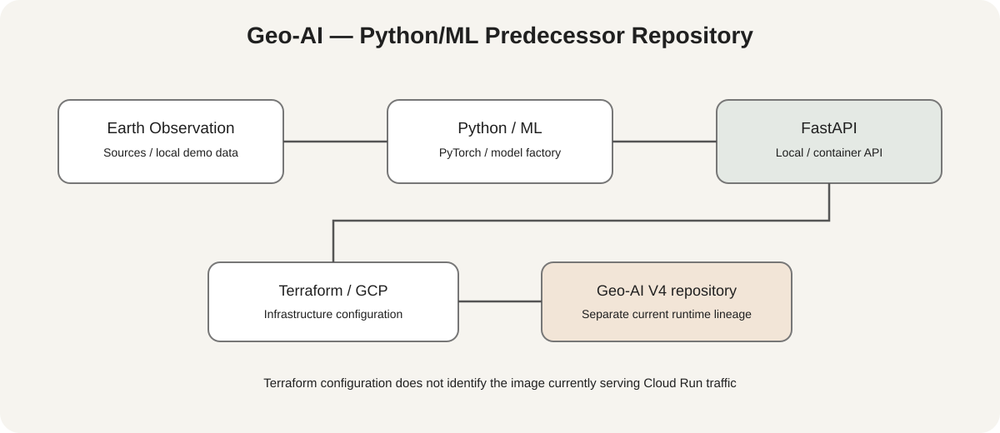

# Triminds Geo AI

## Geospatial AI Platform for Earth Observation

**Triminds Geo AI** is a modular geospatial AI platform for satellite and Earth Observation workflows, combining machine learning, geospatial processing, FastAPI and cloud-native deployment.

The platform is designed around a provider-oriented architecture so that geospatial data sources, representation models, inference components and deployment environments can evolve independently.

---

## Relationship to Geo-AI V4 and deployment evidence

This repository contains the earlier Python/FastAPI, ML and Terraform-oriented Geo-AI implementation. It is distinct from the current **Trimindslabs-Geo-AI-V4** repository, whose deployed application uses Node.js/Express and TypeScript.

The service URL previously associated with this project is historical evidence only; this README does not assert that this repository's Python application is the code currently serving that URL. Verify the Cloud Run service's current image digest, source commit, revision and traffic before claiming a live deployment for this repository.



---

## Architecture

The platform follows a provider-based geospatial AI architecture:

```text
Earth Observation Sources
        │
        ▼
   Provider Layer
        │
        ▼
Ingestion / Validation
        │
        ▼
Geospatial Representation
        │
        ├───────────────┐
        ▼               ▼
 Deep Learning      Vector / Search
        │               │
        └───────┬───────┘
                ▼
             FastAPI
                │
                ▼
          Cloud Run
                │
                ▼
       Operational Service
```

The architecture is intended to support multiple Earth Observation providers and representation strategies without coupling the application to a single data source.

---

## Repository execution paths

The repository contains two complementary execution paths.

### Historical cloud deployment reference

A Cloud Run URL was previously associated with this ecosystem. The live image provenance has not been established for this Python repository, so the URL is not presented here as proof that this code is currently serving traffic.

### Local Demo

The repository also maintains a deterministic local demonstration path for development and reproducibility.

The local path uses:

- synthetic RGB data
- PyTorch
- ResNet50
- local model training
- checkpoint generation
- FastAPI inference

The synthetic dataset is intentionally a software-validation mechanism. It should not be interpreted as a benchmark or as real satellite imagery.

---

## Local Quick Start

### 1. Install

```bash
python -m venv .venv
source .venv/bin/activate
pip install -e ".[dev]"
```

Windows PowerShell:

```powershell
python -m venv .venv
.venv\Scripts\Activate.ps1
pip install -e ".[dev]"
```

### 2. Train the demo model

```bash
bash scripts/train.sh
```

The training script creates a small deterministic synthetic RGB dataset when the demo data is unavailable.

Training produces a checkpoint under:

```text
artifacts/
```

### 3. Start the local API

```bash
CONFIG_PATH=config/demo.yaml uvicorn src.deployment.api.main:app --host 0.0.0.0 --port 8000
```

Windows PowerShell:

```powershell
$env:CONFIG_PATH="config/demo.yaml"
uvicorn src.deployment.api.main:app --host 0.0.0.0 --port 8000
```

Verify:

```bash
curl http://localhost:8000/health
curl http://localhost:8000/classes
```

Inference:

```text
POST /predict
```

---

## Containerization

The API can also be executed as a container.

```bash
bash scripts/deploy.sh
```

The container exposes port `8000` and provides a health-check endpoint.

---

## Model Layer

The model factory supports multiple architectures, including:

- ResNet
- EfficientNet
- Vision Transformers
- hybrid configurations

An embedding adapter is available for workflows based on higher-dimensional foundation-model representations.

The local demonstration deliberately uses:

```text
RGB → ResNet50
```

This local path is independent from specialized satellite-embedding configurations.

---

## Earth Observation Direction

The architecture is designed to accommodate Earth Observation sources and representation systems such as:

- Google Satellite Embeddings
- Google Earth Engine
- Sentinel-2
- Landsat
- additional providers

The objective is to maintain a modular boundary between data acquisition, representation, machine learning and inference.

---

## MLOps

The repository includes MLOps-oriented components such as:

- MLflow integration
- local model registry
- model artifacts
- configurable training pipelines

These components can be enabled according to the deployment environment.

---

## Google Cloud configuration and status

This repository contains Terraform modules and a Python/FastAPI container path for Google Cloud. These files describe configurable infrastructure; they do not prove that the Python application is the image currently serving Cloud Run traffic.

The current Node.js/Express application and its Cloud Run deployment workflow are maintained in the separate [Trimindslabs-Geo-AI-V4 repository](https://github.com/RodrigoDiasDeOliveira/Trimindslabs-Geo-AI-V4). Keep the two implementation lineages distinct.

| Evidence area | Status in this repository |
|---|---|
| Python/FastAPI and ML code | Present |
| Terraform/GCP definitions | Present; target values require review |
| Local demo and synthetic dataset | Development/validation path; not real satellite imagery |
| Latest recorded main-branch CI | Success on 2026-09-15, commit `a67bf53303` ([run](https://github.com/RodrigoDiasDeOliveira/Trimindslabs-Geo-AI/actions/runs/35007375746)) |
| Current Cloud Run revision built from this repository | Not verified |
| Current live revision and image provenance | Must be checked in GCP before any deployment claim |

## Production Readiness

Do not classify this repository as currently operational based only on Terraform files, an old service URL, or a successful historical CI run. Before making a live deployment claim, record the Cloud Run service, project, region, revision, immutable image digest, source commit, traffic allocation and verification timestamp.

The current V4 runtime has its own documented deployment workflow and implementation constraints in the separate repository. Historical deployment evidence may remain useful, but must not be attributed to this Python repository without matching image provenance.

---

## Quality Checks

```bash
ruff check .
ruff format --check .
pytest
pre-commit run --all-files
```

---

## License

MIT License


## Architecture Decision Records

See [docs/adr/README.md](./docs/adr/README.md) for the proposed repository/deployment identity decision.
